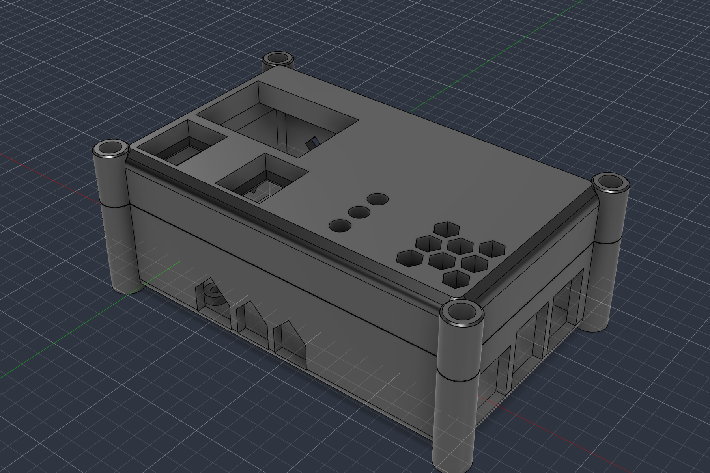
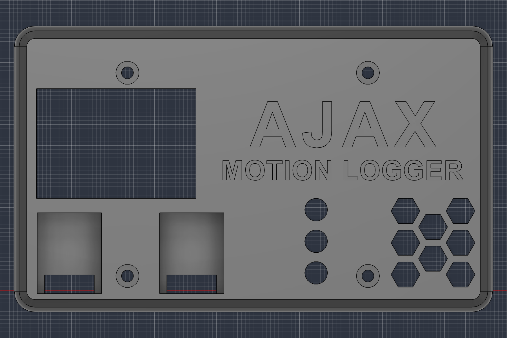
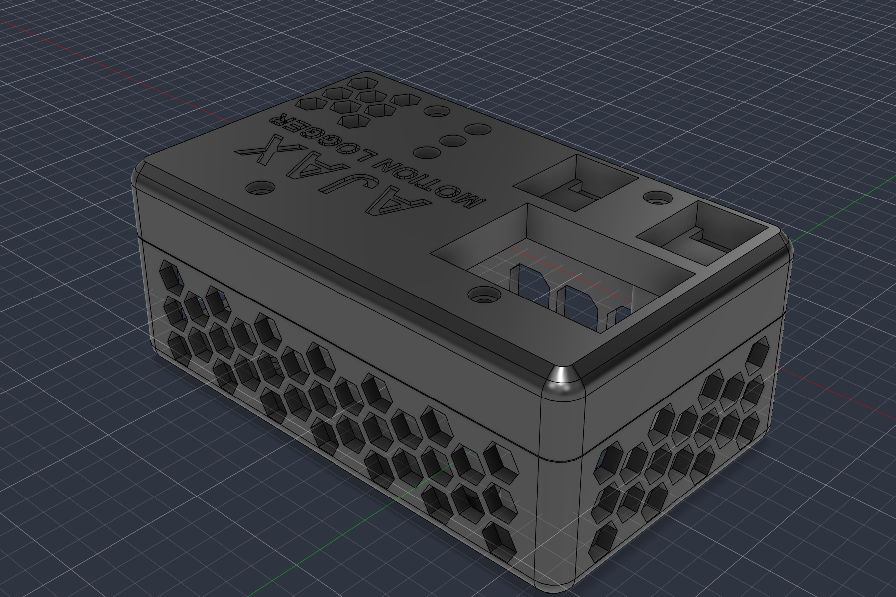

# TASK_05 — плата Motion Logger для Raspberry Pi 5 і корпус для 3D-друку

Завдання: намалювати в Altium плату-модуль, яка вставляється датчиками й одягається на Raspberry Pi, експортувати її у STEP, відкрити у Fusion і зробити корпус, у якому стоять Raspberry Pi і плата. Окремо — код під Raspberry Pi (поки демонстраційний).



**Стан (27.10.2026):** плата v3 виправлена за зауваженнями викладача (10.10.2026), DRC без порушень, **плату замовлено 13.10.2026**, спаяну плату отримано й перевірено на Raspberry Pi 5 (25.10.2026). Корпус **v4 надруковано (30.10.2026)**: усі отвори збіглися, стінки гладкі, для тестів годиться. За результатами друку скрипт переписано на **v5**: кришка кріпиться до основи окремими гвинтами M3, напис прибрано, вентиляція ромбами, посилено перемичку над USB, ширше вікно microSD (див. розділ 2). STL, STEP і картинки v5 ще треба перебудувати у Fusion.

## Структура репозиторію

```
TASK_05/
├── altium/                      проєкт Altium Designer (відкривати Motion_Logger.PrjPcb)
│   ├── Motion_Logger.PrjPcb     файл проєкту
│   ├── Schematic/Sheet2.SchDoc  схема
│   ├── PCB/PCB2.PcbDoc          плата 85 × 60,77 мм, 2 шари
│   ├── Library/                 власні бібліотеки: символи (Schlib2) і футпринти (PcbLib2)
│   ├── Fab/                     файли для виробництва (ZIP: Gerber + свердління) і STEP плати
│   ├── scripts/                 два скрипти Altium (Delphi), якими виправлено товщину шовкографії
│   ├── Project Outputs for Motion_Logger/   результат експорту і звіт перевірки правил (DRC), 0 помилок
│   └── CAMtastic*.Cam           службові файли Altium для Gerber
├── fusion/                      проєкт Fusion
│   ├── output/                  результат: STL для друку, STEP збірки, лог скрипта
│   ├── inputs/                  вхідний STEP: спрощена модель Pi 5
│   ├── script/                  скрипт Fusion (Python), що будує корпус
│   ├── tools/                   допоміжні скрипти (Python)
│   └── images/                  картинки: вигляд моделі, кришка і основа зверху
├── docs/                        PDF для примірки на папері в масштабі 1:1 (плата і корпус)
└── code/                        демонстраційний код для Raspberry Pi (Python), буде змінюватися
```

## 1. Altium: плата Motion Logger

Плата розміром **85 × 60,77 мм**, кути заокруглені R2, 2 шари, товщина **1,5 мм**. Вона одягається на гребінку 2×20 Raspberry Pi 5 і **виступає ліворуч над Pi приблизно на 20 мм**, тому не накриває роз'єми USB та Ethernet (права кромка плати за 65 мм від лівого краю Pi). Кріпильні отвори ⌀2,7 мм на 58 × 49 мм збігаються з отворами Pi (відступ без міді навколо них 1,5 мм). Початок координат плати стоїть на піні 1 гнізда `J1`. Власних джерел живлення на платі нема: 3,3 В беруться з Pi.

Модулі й елементи на платі:

| Позначення | Що це | Інтерфейс |
|---|---|---|
| `U1` | GPS NEO-6M (модуль HW-623), у виступі ліворуч | UART |
| `U2` | GY-87 (HW-290): MPU6050 + HMC5883L + BMP180 | I2C |
| `U3` | ADXL345 (модуль GY-291) | SPI |
| `SW1`, `SW2` | дві кнопки (модуль HW-483 / KY-004, 15 × 19 мм), у корпусі лежать у нішах кришки, з'єднання дротами | GPIO |
| `D1`–`D3` + `R1`–`R3` | RGB-світлодіод з трьох окремих світлодіодів і резисторів: червоний 220 Ом, синій 100 Ом, зелений 100 Ом | GPIO |
| `J1` | гніздо 2×20 під Raspberry Pi 5 | — |
| `DBG1` | гребінка для USB-UART налагодження (GND, TX, RX) | UART |

### Підключення пінів Pi 5

| Пін `J1` | GPIO | Мережа | Куди |
|---|---|---|---|
| 1, 17 | 3V3 | `VCC` | живлення модулів і кнопок |
| 6, 9, 14, 20, 25, 30, 34, 39 | GND | `GND` | земля |
| 3 / 5 | GPIO2 / GPIO3 | `I2C_SDA` / `I2C_SCL` | GY-87 |
| 7 / 29 | GPIO4 / GPIO5 (uart2) | `UART_TX` / `UART_RX` | GPS |
| 19 / 21 / 23 / 24 | GPIO10 / 9 / 11 / 8 | `SPI_MOSI` / `MISO` / `SCLK` / `CS0` | ADXL345 |
| 11 / 33 | GPIO17 / GPIO13 | `BTN` / `BTN2` | кнопки `SW1` / `SW2` |
| 13 / 15 / 31 | GPIO27 / GPIO22 / GPIO6 | `LED_R` / `LED_G` / `LED_B` | світлодіоди |

### Зауваження викладача (10.10.2026) і що зроблено
| Зауваження | Що зроблено |
|---|---|
| отвори під Pi | чотири кріпильні отвори ⌀2,7 мм, кільця Keep-Out навколо отворів Pi і GPS |
| початок координат на піні 1 | початок координат (Edit → Origin → Set) на піні 1 `J1` |
| заокруглені кути, логотип | контур з R2; напис «4AJAX» і «Motion Logger v2» міддю на верхньому шарі |
| клас цепей `Power` | клас `Power` і правило ширини для живлення (мін. 0,3, бажана 0,5, макс. 1,0 мм) |
| плавні кути доріжок | правило `Routing Corners` (закруглення) і повне перетрасування автотрасувальником; кутів 90° на вигинах нема (лишилась лише розвилка двох доріжок у піні `U1-1`) |
| краплі | краплі на всіх контактних площадках і перехідних отворах |
| замок на `J1` | гребінку заблоковано під час компонування; у фінальному файлі блокування знято, бо воно спричиняло помилки `Net Antennae` в DRC (причину знайдено розбором файлу), положення тримають початок координат і кріпильні отвори |

Також: два полігони землі (`GND`) на верхньому й нижньому шарі; плата не накриває порти Pi.

### Перевірка правил і вимоги виробника
DRC: **0 порушень, 0 попереджень** (звіт: `altium/Project Outputs for Motion_Logger/Design Rule Check - PCB2.html`). Під вимоги виробника pcb24.com.ua (мінімальна доріжка і зазор 0,2 мм, отвір 0,3 мм, шовкографія 0,15 мм, товщина 1,5 мм, назви файлів, міліметри) у проєкті налаштовано: правило `HoleSize` ≥ 0,3 мм; усі лінії шовкографії ≥ 0,15 мм (скрипти `altium/scripts/FixSilk2.pas` і `FixSilk3.pas`); стек плати (мідь + діелектрик) 1,50 мм; експорт Gerber і NC Drill у міліметрах, формат 4:3, з назвами шарів `PCB2_Top`, `PCB2_Bot`, `PCB2_TopMask`, `PCB2_BotMask`, `PCB2_TopSilk`, `PCB2_BotSilk`, `PCB2_Board`.

Файли для виробництва: `altium/Fab/Motion_Logger_Gerber_NCDrill.zip` (9 файлів: 6 шарів, контур, свердління з металізацією `Drill_Plated` і без неї `Drill_NoPlated`). STEP плати: `altium/Fab/Motion_Logger_board.step`. Актуальні експортовані файли також лежать у `altium/Project Outputs for Motion_Logger/` з префіксом `PCB2_`. Файли без підкреслення (`PCB2.GTL`, `PCB2.GBL` та інші) там залишились від попереднього експорту (дюйми); вони потрібні лише тому, що проєкт посилається на них, для виробництва їх використовувати не треба.

Плату замовлено 13.10.2026 в pcb24.com.ua (двостороння, FR4, 1,5 мм).

Версія Altium Designer, у якій зроблено проєкт: 26.10.1.

## 2. Fusion: корпус

Корпус складається з **основи** і **кришки**. Усередині: Raspberry Pi 5 на 4 стійках, над ним на стійках M2.5 довжиною 11 мм плата Motion Logger. Плата стоїть на гнізді `J1` (як HAT), тому подовжувач гребінки більше не потрібен. Плата прикручується до стійок короткими гвинтами M2.5 і кришки не торкається: кришка тримається лише на 4 кутових колонах, тож корпус закривається й порожнім.





Модель збудовано скриптом Fusion (Python API) за розмірами плати і спрощеної моделі Raspberry Pi 5 (з офіційного STEP). Плата в скрипті будується простим тілом за її розмірами й отворами.

Головні розміри (мм; система координат: лівий нижній кут Pi 5 = (0;0), Z = 0 — верх плати Motion Logger):

| Що | Значення |
|---|---|
| Зовнішній розмір корпусу | 115,4 × 69,0 × 47,3 (з кутовими колонами 125,4 × 79,0) |
| Плата Motion Logger у цій системі | x −19,8…65,2, y −0,77…60,0 (виступає ліворуч над краєм Pi) |
| Стінки / дно / верх кришки | 3,0 / 3,0 / 7,5 |
| Закруглення | вертикальні кути R5; ребро біля столу (низ основи, верх кришки): фаска 45° на 3 мм зі згладженням R4, тож нависання не крутіші за 45° і друк без підтримок |
| Висота від верху плати Pi до низу плати Motion Logger | 11,0 (довжина стійок M2.5; 2,57 пластик гребінки Pi + 8,5 гніздо `J1`) |
| Висота над платою Motion Logger | 20,0 |
| Стійки під Pi | ⌀7, висота 3,0, гвинти M2.5 знизу; дві опори ⌀6 під виступ плати |
| Кришка | 4 гвинти M3 довжиною 17–22 мм (краще 18–21) згори крізь колони на зовнішніх кутах; гайка M3 вкладається в шестигранний паз основи збоку (не вплавляється) |

Вікна й отвори:
- Права стіна: Ethernet і два блоки USB Raspberry Pi. Розмір вікон як у v4, верх плоский: перемичка над USB 6,5 мм (у v4 дах 45° лишав 1,7 мм, і перемичка відламалась). Ці три вікна єдині, де слайсер поставить підтримку.
- Нижня стіна: USB-C живлення і два micro-HDMI, верх вікон гострий дах 45° без плоскої частини.
- Дно: 5 щілин під процесором (пасивне охолодження). Вікно microSD 20 мм завширшки тягнеться від картки до лівої стінки, а в стінці є виріз із дахом 45°, щоб дістати картку пальцем.
- Вентиляція: на задній і лівій стінках основи 31 ромб (діагональ 8 мм, перемичка 2,5 мм, грані 45°, тож без мостів і підтримок), на верху кришки над правою частиною Pi 8 сот (вертикальні отвори). Повітря заходить через ромби й щілини в дні й виходить через соти на кришці.
- Верх кришки плоский, напис буде наклейкою.
- Кришка: 3 отвори ⌀5,5 над світлодіодами (без світловодів), вікно на весь модуль GPS, **дві ніші під модулі кнопок** 15,5 × 19,5 × 5,5 мм. Дно ніші — полиця 45° шириною 1,5 мм, далі наскрізний отвір 12,5 × 16,5 мм і щілина 12 × 4,5 мм під дроти. Стелі нема, тож підтримка в ніші не потрібна. Гнізда головок гвинтів ⌀6,2 закінчуються конусом 45°, а не стелею, яка у v4 запечатувала отвори.

Перевірки: у Fusion аналіз перетинів (`analyzeInterference`) не знайшов перетинів основи й кришки з платою та Pi (результат у `fusion/output/script_log.txt`, рядок `with case: 0`: усі збіги лише всередині моделі Pi). Для друку `fusion/tools/check_printability.py` рахує замкнутість сітки, контакт зі столом і нависання: обидва STL замкнені, нависань крутіших за 45° нема. Цифри стель (мостів) у v4: основа 792 мм², кришка 887 мм². Для v5 їх треба перерахувати після перебудови STL; очікується, що в кришці стель не лишиться, а в основі будуть лише верх трьох вікон правої стінки і пази гайок (6 мм).

### Друк
Використовуй STL з `fusion/output/`:
- `Case_Base_print.stl` — основа, друкувати як є (дном вниз), висота 32,8 мм. Підтримка потрібна лише у трьох вікнах правої стінки;
- `Case_Lid_print_flipped.stl` — кришка, уже перевернута верхом на стіл, підтримки не потрібні.

Збирання: Pi на стійки основи (M2.5 знизу), плата на стійки 11 мм (короткі M2.5 згори), кришка зверху, гайки M3 вкласти в пази на кутах основи, гвинти M3 18–21 мм згори.

Рекомендований матеріал: PETG (біля Pi 5 PLA може розм'якнути). Зазори 0,2–0,3 мм і стінки 3 мм — загальні правила, не перевірені на конкретному принтері; отвори під M2.5 зроблено ⌀2,9, бо друк звужує їх приблизно на 0,2 мм. v4 надруковано 30.10.2026, усі отвори збіглися; v5 ще не друкувався.

PDF для примірки на папері 1:1 (A4, друкувати без масштабування): `docs/Plata_paper_1to1.pdf` (плата й контур Pi) і `docs/Korpus_paper_1to1.pdf` (кришка, основа, вікна в стінках; PDF зроблено для v3: положення вікон і отворів у v4 те саме, змінились лише закруглення, соти й напис).

### Як відкрити й змінити
- Змінити розмір: поправ параметри на початку `fusion/script/MotionLoggerCase.py` (`H`, `CAV`, `LT`, `POCKET`, `BTN`, вікна). У Fusion: `Utilities → Add-Ins → Scripts and Add-Ins` → `+` → `Script or add-in from device` → вибрати папку `fusion/script` → `Run`. Скрипт створить новий документ і запише STL/STEP та лог у `fusion/output/`.
- Файл Fusion (`.f3d`) у репозиторії не зберігається: модель будується скриптом за хвилину.

## 3. Код для Raspberry Pi
Папка `code/` містить **демонстраційний** код (`motion_logger_demo.py`): читає MPU6050, ADXL345, GPS і кнопки, пише CSV-лог, показує стан світлодіодом. Він простий, на реальному залізі не перевірений і буде змінюватися. Опис і запуск: [code/README.md](code/README.md).

## Як зроблено корпус (коротко)
1. Плату намальовано в Altium, розміри й положення елементів взято з файлу плати (початок координат на піні 1 `J1`, перерахунок у систему Pi: додати (8,37; 51,23)).
2. Офіційний STEP Raspberry Pi 5 (Raspberry Pi Ltd, ліцензія MIT) завважкий (77 МБ, 2689 тіл). З нього зчитано габарити роз'ємів і зроблено спрощену модель `fusion/inputs/pi5_proxy.step` (`fusion/tools/make_pi5_proxy.py`).
3. Висоту між Pi і платою розраховано за STEP: пластик гребінки Pi 2,57 мм плюс гніздо `J1` 8,5 мм; роз'єми USB стоять на 16,2 мм над платою Pi, тому плата не накриває їх.
4. Скрипт `fusion/script/MotionLoggerCase.py` імпортує модель Pi, будує плату, основу та кришку (тіла з об'ємними логічними операціями), перевіряє перетини й експортує STL і STEP.
5. Результат перевірено: аналіз перетинів у Fusion і `check_printability.py`.

Під час роботи використовувався ШІ-асистент Claude (Anthropic): він читав файли Altium і STEP, рахував розміри, писав скрипти Fusion, Altium і перевірки та готував файли для виробництва. Рішення щодо конструкції (висота стека, гвинти, кнопки в нішах кришки, живлення тільки через USB-C Pi, вікно GPS, товщина стінок, номінали резисторів, вибір виробника) ухвалював я.

## Ліцензії та джерела
- 3D-модель Raspberry Pi 5: Raspberry Pi Ltd, MIT, <https://datasheets.raspberrypi.com/rpi5/RaspberryPi5-step.zip> (в репозиторії лише спрощена модель, зроблена з її розмірів).
